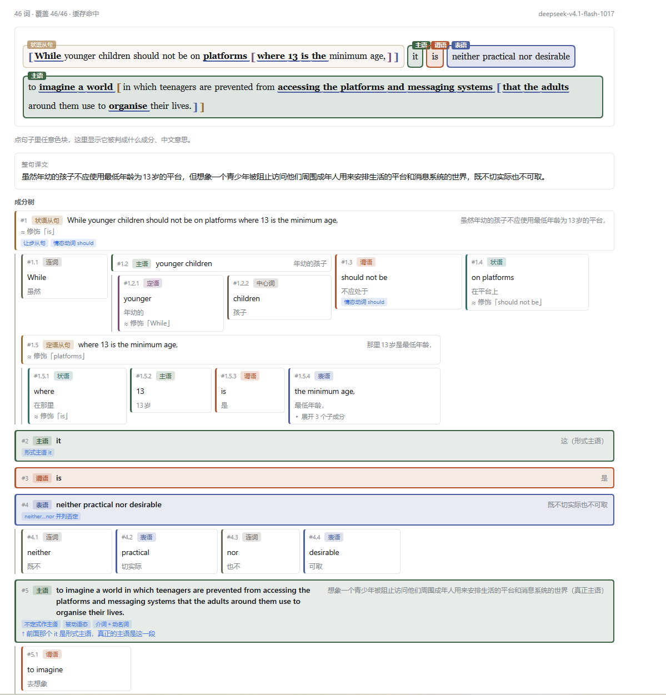
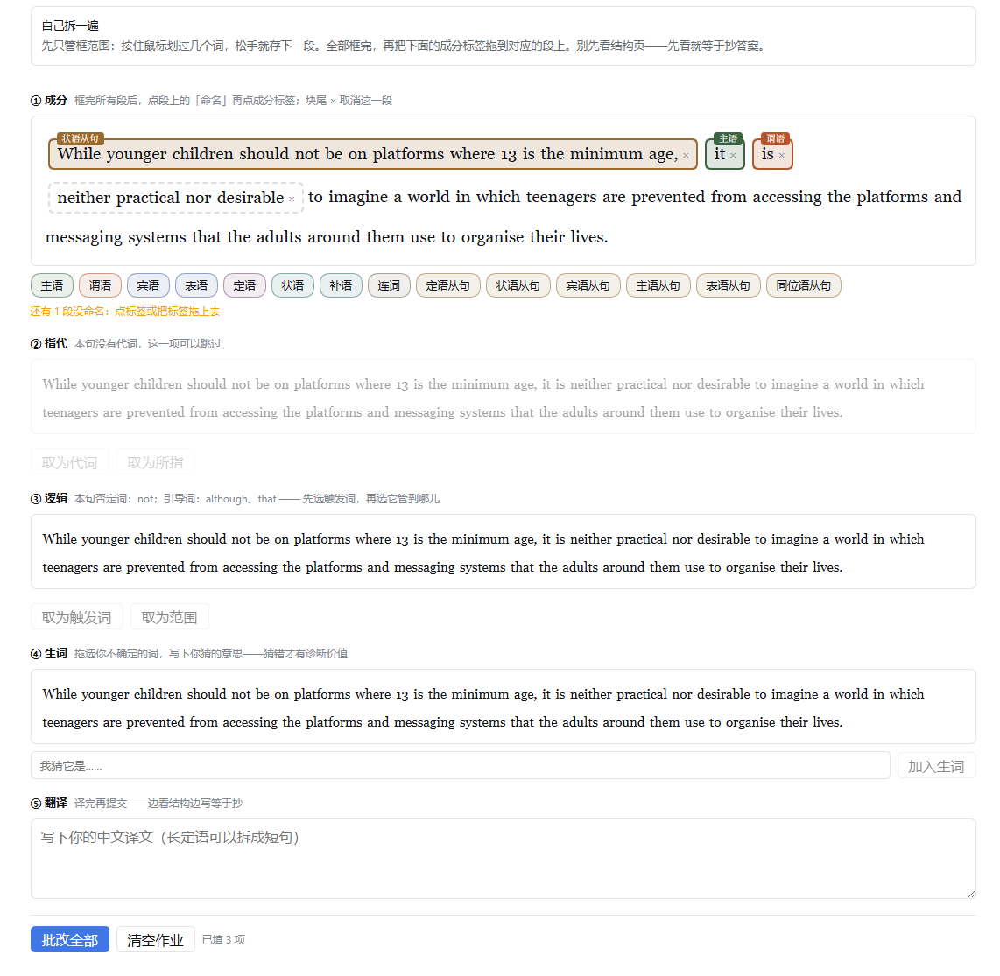

# dsh-english-coach · 英语句子分层诊断

一个给 [DeepSeek Harness](https://github.com/deepseek-ai) 用的插件。**它不是翻译器**——你贴一句读不懂的英文，它先判断你卡在**哪一层**，再按那一层给药。

> 装好之后：侧边栏出现「句子诊断」，主栏是一整页工作台。也可以直接在对话里调用工具。

## 界面预览

**成分树**：拆出主干、从句和修饰归属，附先行词标注、从句边界括号与中文释义。

<p align="center">
  
</p>

**自己拆一遍**：先自己框选、打标签（成分 / 指代 / 逻辑 / 生词 / 翻译），再批改，避免「先看答案等于抄答案」。

<p align="center">
  
</p>

---

## 为什么需要它

「查了单词还是译不出来」几乎从来不是单词量的问题。可能是：

| 现象 | 真实原因 |
|---|---|
| 每个词都认识，句子还是读不通 | 没找到谓语，或从句边界划错了 |
| 查了词典还是译不出来 | 查的是第一个义项，句中用的是第三个；或者你查的是单词，需要的是搭配 |
| 「它」到底指什么说不清 | 指代没解开——`it` 常常指前面一整件事 |
| 否定读反了 | 英语否定的作用范围比中文宽 |
| 全懂了，中文就是写不出来 | **理解对了，但中文组装不出来** |

最后一条最容易被误诊成第一条：于是背了一堆单词，长句照样读不懂。

所以这个插件把诊断拆成**五层**，每层用一种「产出式」任务来测——不是选择题。**选项本身就是提示**，选对了不代表会拆。

## 五层模型

| 层 | 名称 | 你要做的 | 批改依据 |
|---|---|---|---|
| **S** | 句法 | 拖选片段 → 打成分标签（主语/谓语/定语从句…） | 与 LLM 给出的成分树比对 |
| **R** | 指代 | 拖选代词 → 拖选它指的那段 | 是否落在「代词前最近的名词短语 / 前一分句」候选里 |
| **L** | 逻辑 | 拖选否定词或引导词 → 拖选它管到哪 | 否定词的作用域取它所在的从句 |
| **V** | 词汇 | 拖选不确定的词 → 写下你猜的意思 | 命中僻义表则比对义项 |
| **E** | 表达 | 写整句译文 | 逐块检查成分树每段中文有没有出现在译文里 |

判分口径（与常见作文批改一致）：

```
覆盖率 = 标准成分里你标到的比例
准确率 = 你标的里对的比例
总分   = 覆盖率 × 70 + 准确率 × 30
```

重叠 ≥ 50% 且成分名相同即算对——边界差一两个词不算错。

## 界面：四步

### ① 结构

```
[主语] To imagine a world  [定语从句 in which teenagers are prevented from …]
```

- 顶层成分是圆角块，**主干（主/谓/宾/表）重描边**，修饰成分轻一档
- 从句边界用**彩色方括号**标出，嵌套层不同颜色
- 定语从句修饰的那个名词（**先行词**）加粗带下划线
- 下方成分树：横向展开、可折叠、每段带中文、标出修饰对象与语法点

### ② 标注

先只管框范围：按住鼠标划过几个词，松手就存下一段。全部框完，再把成分标签拖（或点）到对应的段上。

五个分区（成分 / 指代 / 逻辑 / 生词 / 翻译）**纵向展开**，各自独立拖选。本句没有对应的素材时整块置灰，并告诉你「可以跳过」。

### ③ 结果

五层逐层给分、逐项对错、漏标清单、错法归因（例如「定语与状语混了」「只标了主干，没往从句里拆」）。

### ④ 画像

跨句累计：各层正确率、最常卡在哪一层、最近趋势。

## 安装

作为 DSH 插件包安装（支持 `link:` 本地路径或 npm 包）：

```bash
# 在你的 DSH profile 目录
pnpm add link:/path/to/dsh-english-coach
```

然后在 `package.json` 的 `dsh.profile.bundles` 里加上 `dsh-english-coach`，重启 DSH。

## 配置 LLM（必需）

成分树由 LLM 生成，**需要自备一个 OpenAI 兼容接口**。在 profile 的 `cordis.patch.yml` 里配置：

```yaml
- id: english-coach
  name: dsh-english-coach
  config:
    llm:
      baseURL: https://api.openai.com/v1
      model: gpt-4o-mini
      apiKeyRef: OPENAI_API_KEY      # 对应 ~/.dsh/.credentials.yaml 里的键名
      timeoutMs: 60000
```

也可以直接写 `apiKey`（不推荐，会进配置文件）。

国内模型示例（任选其一，填自己的端点）：

```yaml
      baseURL: https://open.bigmodel.cn/api/paas/v4
      model: glm-4-plus
      apiKeyRef: ZHIPU_API_KEY
```

**模型选择很重要**：成分树的质量完全取决于模型。实测 `deepseek-v4.1-flash` 约 8–20 秒、结构稳定；太小的模型给不出可用的树——覆盖不足时插件会**直接报错**，不会假装成功。

分析结果按句缓存（`~/.dsh/dsh-english-coach/structure-cache.json`），同一句第二次是毫秒级。

## 对话里使用

也可以不开面板，直接在对话里：

| 工具 | 作用 |
|---|---|
| `en_sentence` `action=analyze` | 拆结构（主干 / 从句归属 / 非谓语 / 指代候选 / 风险提示） |
| `en_sentence` `action=explain` | 给中文重组的译法路线 |
| `en_sentence` `action=note` | 生词与搭配存本地生词本 |
| `en_profile` | 分层正确率与最常卡点 |

## 文章目录

「阅读文章」下拉里的内容来自插件自带的 `paper/` 目录：

```
dsh-english-coach/
└── paper/
    ├── 2026-06-1-B.md
    ├── 2026-06-1-C1.md
    └── ...
```

- 每个 `.md` 是一篇，**普通英文正文即可**——不用标句子位置，插件会自动切句（长句、引号、破折号都处理过）
- 这个目录**不进 git、也不进 npm 包**（已在 `.gitignore` 和 `package.json` 的 `files` 里排除），属于本地学习材料

查找顺序（也可以用 `corpusDir` 显式指定，优先级最高）：

1. `<插件目录>/paper/` ← 推荐，跟着插件走
2. 与 `plugins/` 同级的 `paper/`
3. `<插件目录>/../paper/`
4. 当前工作目录下的 `paper/`（兜底）

## 已知限制

诚实说明：

1. **规则引擎会误判**。分词、词性、从句边界都是规则 + 词表，不是统计模型。`that` 的三义、`-ed` 是谓语还是分词，偶尔会错。
2. **成分树依赖模型质量**。同一个句子换模型，切分可能不同。
3. **语法点标签是规则检测**，覆盖常见结构，认不出就不标——是提示，不是判决。
4. **只测「做没做到」，不测「为什么」**。同样错在一层，可能是义项选错，也可能是没看见，归因需要你自己结合错题看。

## 数据与隐私

- 所有记录只写本机：`~/.dsh/dsh-english-coach/`
- 不外发任何学习数据
- LLM 请求只发送**当前这一句英文**，不发送历史记录

## 开发

```
lib/                  引擎
  lexicon-core.js     功能词、不规则动词、构词后缀
  lexicon-tips.js     熟词僻义、搭配表、学术词义项
  segment.js          分词与粗词性
  parse.js            从句边界、主干、修饰归属、指代候选
  annotate.js         解析结果 → 字符级 span
  structure.js        LLM 成分树 + token 对齐 + 缓存
  grade-spans.js      成分标注批改
  grade-tasks.js      指代 / 逻辑 / 词汇 / 表达批改
  store.js            本地记录与画像
  api.js              HTTP 接口
client.js             面板（手写 React，无构建）
skills/               技能定义
```

测试：

```bash
node test/client.mjs    # 面板渲染（不依赖 LLM，缓存命中即可跑）
node test/api.mjs       # HTTP 接口
node test/tasks.mjs     # 五类判定（需要 LLM 可用）
node test/e2e.mjs       # 工具端到端
```

## License

MIT